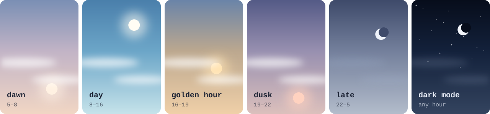
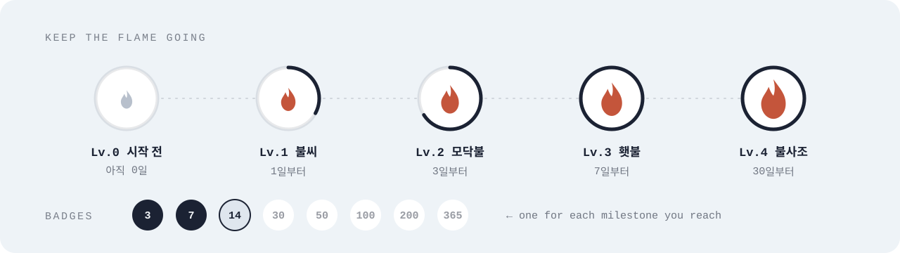
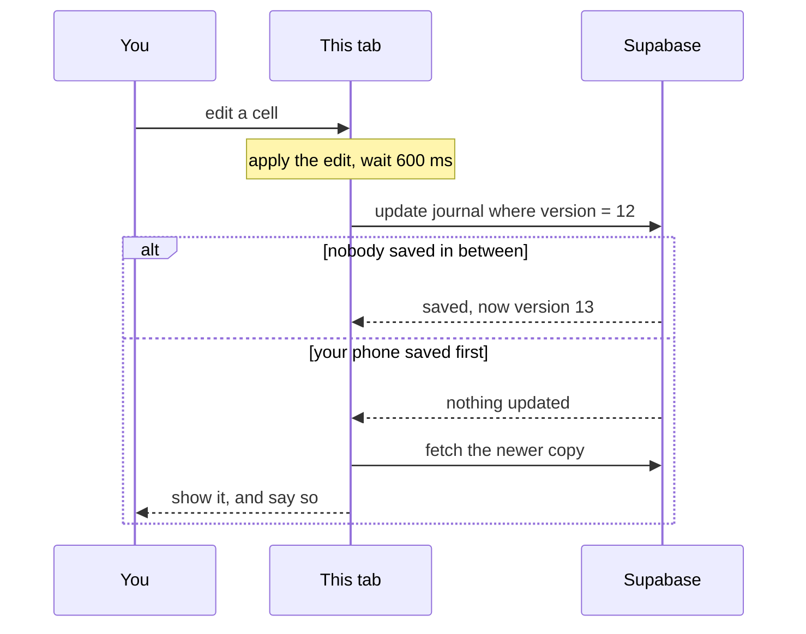

<div align="center">

<a href="https://jamieryu.com/myselfcare/"></a>

<br>
<br>


</div>

<br>

My Self Care is a small journal for three things: what goes on your skin, how your body is doing, and what you'd like to wear. It's set in a typewriter face, it opens with a short note addressed to you, and it sits under a sky that changes with the hour.

It lives at **[jamieryu.com/myselfcare](https://jamieryu.com/myselfcare/)**.

## The sky



The background is painted from the clock. A tiny inline script picks one of five skies before the first frame, so the page never flashes the wrong one, and `SkyClock` checks again every five minutes while the tab is open. Dark mode skips the clock and always shows the night sky, stars included.

Every pane on top of it is frosted glass in the same ink, so the sky shows through without getting in the way of what you're writing.

## Keeping a streak



Every day in the routine timeline has a done box. Check it and the flame grows: the ring around it fills toward the next milestone, and each milestone you pass leaves a badge behind. An unchecked today doesn't break anything until the day is actually over, so last night's streak is still safe at breakfast.

## What else is in here

### Skin

A week-at-a-glance routine (morning, face, evening cleanse, skincare, notes). Double-click a cell to write in it, repeat a step every few days without retyping it, tick off grooming like shaving or a mask, and note how your skin felt. Products and the videos you learned from have a shelf of their own.

### Body

Weight check-ins with a trend chart and BMI. Next to them, a library of workouts sorted by body part and meals sorted by time of day, each with a link, a note and a photo.

### Style

A board for outfits, fragrances, hairstyles and the things you want to buy next.

Everything saves on its own. Deleting something gives you a few seconds to undo it, and the whole journal can be exported to JSON and imported again.

## How saving works

The journal is one JSON document per person. Edits are batched for a moment and then written back, but only if nobody else has saved since:



So a forgotten laptop tab can't quietly overwrite what you wrote on your phone. Photos are resized in the browser and stored in a private bucket under your user id.

## Running it yourself

```bash
npm install
cp .env.example .env.local   # fill in the Supabase URL and anon key
npm run dev
```

The app is served under its base path, so open **http://localhost:3000/myselfcare/**. `npm run lint` and `npm run build` (a static export to `out/`) are the other two scripts.

### The database

Run the SQL in `supabase/migrations/` from the Supabase SQL editor, in order:

| File | When |
| --- | --- |
| `0001_revoke_legacy_sessions.sql` | Immediately. Logs out every session of the old static site. |
| `0002_journal_documents.sql` | Before deploying. Creates the journal table, RLS policies and the `journal-images` bucket. |
| `0003_import_legacy_account.sql` | After re-signing up with your old username. Copies the old account's data to the new one. |
| `0004_drop_legacy_auth.sql` | Once everything is migrated. Removes the old username/password tables and functions. |

<details>
<summary>Signing in with a username</summary>
<br>

Users sign in with a username and password. Supabase Auth needs an email, so each username is stored as `<username>@users.jamieryu.com` (see `src/lib/auth/username.ts`); no mail is ever sent there.

In Supabase → Authentication → Sign In / Providers → Email, **turn off "Confirm email"**. Otherwise sign-ups can't log in, and Supabase would try to send confirmation mail to addresses that don't exist.

There's no "forgot password" flow because accounts have no real email. As the project owner you can reset someone's password from the SQL editor:

```sql
update auth.users
set encrypted_password = extensions.crypt('NEW_PASSWORD', extensions.gen_salt('bf'))
where email = 'USERNAME@users.jamieryu.com';
```

</details>

### Deploying

It's a static export (`output: "export"`, `basePath: "/myselfcare"`) on GitHub Pages, so there's no server: sign-in and loading happen in the browser, and row-level security keeps each journal private.

- `.github/workflows/deploy.yml` lints, builds and publishes on every push to `main`.
- Settings → Pages → Source must be **GitHub Actions**.
- Settings → Secrets and variables → Actions → **Variables**: `NEXT_PUBLIC_SUPABASE_URL` and `NEXT_PUBLIC_SUPABASE_ANON_KEY`. Both are public values.

## Where things live

```text
src/
├─ app/                  fonts, and the theme + sky applied before first paint
├─ components/
│  ├─ AppRoot.tsx        follows the Supabase session and loads your journal
│  ├─ SkyClock.tsx       keeps the sky in step with the hour
│  └─ journal/
│     ├─ useJournalStore.ts   edits, autosave and the version check above
│     ├─ skin/ body/ style/   one folder per tab
│     └─ shared/              photo upload, undo-able deletes
├─ lib/journal/          types, dates, repeats, and loading every older save format
└─ styles/               the sky, the panes, and the small screens
```

<br>

<div align="center">
<sub><a href="https://github.com/mijnap1">@mijnap1</a></sub>
</div>
