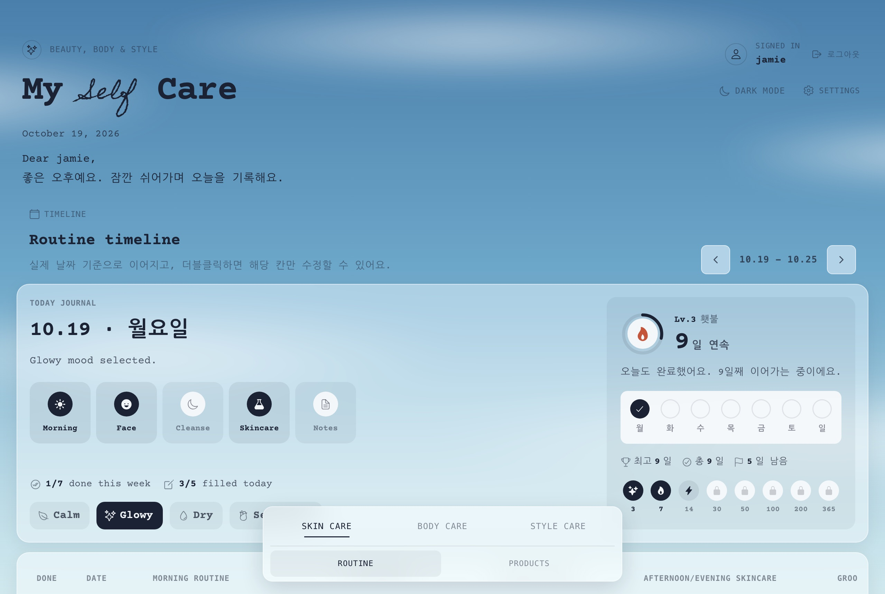

<div align="center">

<picture>
  <source media="(prefers-color-scheme: dark)" srcset="docs/preview-dark.jpg">
  
</picture>

<br>
<br>

# My Self Care


<br>

[](https://github.com/mijnap1/myselfcare/actions/workflows/deploy.yml)


**[Open the journal →](https://jamieryu.com/myselfcare/)**

<sub>[What's inside](#whats-inside) · [Getting started](#getting-started) · [Database](#database) · [Deploying](#deploying) · [How it works](#how-it-works)</sub>

</div>

<br>

## What's inside

A personal self-care journal that reads like a letter: typewriter text on a sky that follows the time of day, and a night sky in dark mode.

| | |
| --- | --- |
| **Skin care** | A weekly routine timeline (morning, face, cleanse, skincare, notes) with repeats, a grooming checklist, moods, and a shelf for products and skincare videos. |
| **Body care** | Weight check-ins with a trend chart and BMI, plus a library of workouts by body part and meals by time of day, each with a link, a note and a photo. |
| **Style care** | A board for outfits, fragrances, hairstyles and a wishlist. |
| **Streaks** | Check off a day to keep the flame going: levels, a ring toward the next milestone, and badges at 3, 7, 14, 30 … 365 days. |
| **Everywhere** | Autosave with conflict-safe sync across devices, undo for deletes, JSON export and import, and a light and dark theme. |

## Stack

| Layer | |
| --- | --- |
| App | Next.js 16 (App Router, static export), React 19, TypeScript |
| Data | Supabase Auth, Postgres with row-level security, Supabase Storage for images |
| State | One JSON document per user, edited with immer and autosaved with optimistic versioning |
| Look | Plain CSS in `src/styles/`, Courier Prime + Nanum Gothic Coding, Ionicons |
| Hosting | GitHub Pages, built by GitHub Actions |

## Getting started

```bash
npm install
cp .env.example .env.local   # fill in the Supabase URL and anon key
npm run dev
```

The app is served under its base path: open **http://localhost:3000/myselfcare/**.

| Script | |
| --- | --- |
| `npm run dev` | Development server |
| `npm run build` | Static export to `out/` |
| `npm run lint` | ESLint |

## Database

Run the SQL in `supabase/migrations/` from the Supabase SQL editor, in order:

| File | When |
| --- | --- |
| `0001_revoke_legacy_sessions.sql` | Immediately. Logs out every session of the old static site. |
| `0002_journal_documents.sql` | Before deploying. Creates the journal table, RLS policies and the `journal-images` bucket. |
| `0003_import_legacy_account.sql` | After re-signing up with your old username. Copies the old account's data to the new one. |
| `0004_drop_legacy_auth.sql` | Once everything is migrated. Removes the old username/password tables and functions. |

<details>
<summary><b>Username login</b></summary>
<br>

Users sign in with a username and password. Supabase Auth needs an email, so each username is stored as `<username>@users.jamieryu.com` (see `src/lib/auth/username.ts`); no mail is ever sent there.

In Supabase → Authentication → Sign In / Providers → Email, **turn off "Confirm email"**. Otherwise sign-ups can't log in, and Supabase would try to send confirmation mail to addresses that don't exist.

There's no "forgot password" flow because accounts have no real email. As the project owner you can reset someone's password from the SQL editor:

```sql
update auth.users
set encrypted_password = extensions.crypt('NEW_PASSWORD', extensions.gen_salt('bf'))
where email = 'USERNAME@users.jamieryu.com';
```

</details>

## Deploying

The app is a static export (`output: "export"`, `basePath: "/myselfcare"`) served at [jamieryu.com/myselfcare](https://jamieryu.com/myselfcare/).

- `.github/workflows/deploy.yml` lints, builds and publishes on every push to `main`.
- Settings → Pages → Source must be **GitHub Actions**.
- Settings → Secrets and variables → Actions → **Variables**: `NEXT_PUBLIC_SUPABASE_URL` and `NEXT_PUBLIC_SUPABASE_ANON_KEY` (public values; RLS protects the data).

There is no server: sign-in and data loading happen in the browser, and the session is kept in localStorage.

## How it works

```text
src/
├─ app/                  layout (fonts, theme + sky before first paint) and the single page
├─ components/
│  ├─ AppRoot.tsx        follows the Supabase session and loads the user's journal
│  ├─ SkyClock.tsx       keeps html[data-sky] in step with the time of day
│  └─ journal/
│     ├─ useJournalStore.ts   the document: immer edits, autosave, conflict handling
│     ├─ skin/ body/ style/   one folder per section
│     └─ shared/              image upload, undo-able removal
├─ lib/journal/          types, normalisation of every stored version, dates, repeats
└─ styles/               base tokens and sky, components, responsive rules
```

- **Saving.** Every save is conditional on the `version` it loaded. A stale tab gets the newer copy instead of overwriting it.
- **Images.** Photos are resized to JPEG in the browser and uploaded to a private bucket under `<user id>/`. Base64 images from the old app are moved there on first load.
- **Old data.** `normalizeJournalData` accepts every shape the journal has ever been stored in, so old exports and documents keep loading.
- **The sky.** `getSkyPeriod` picks dawn, day, golden hour, dusk or late evening from the local hour. An inline script applies it before first paint, and the CSS reads it as `--sky-*` tokens.

<br>

<div align="center">
<sub>Made by <a href="https://github.com/mijnap1">@mijnap1</a></sub>
</div>
